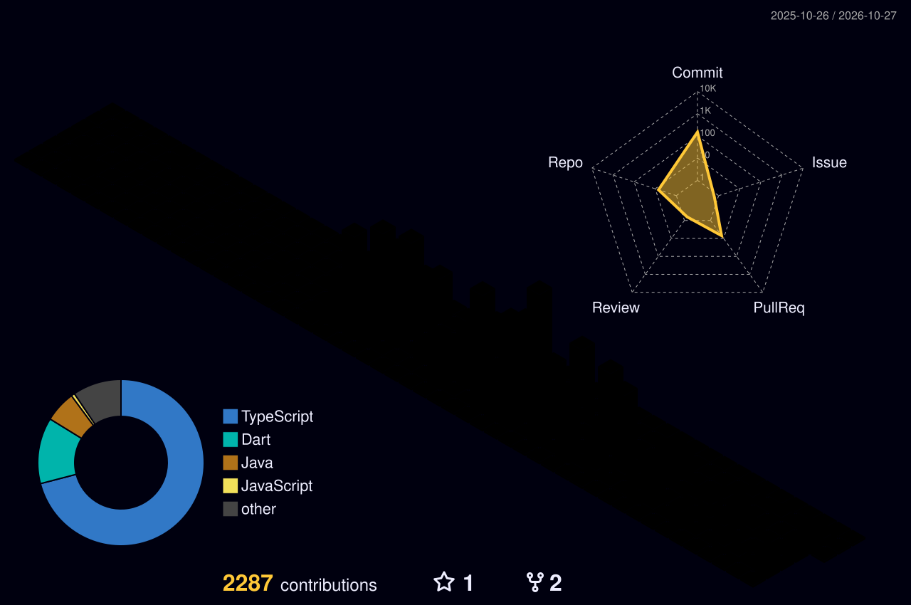

# Heey, tudo bem? 

Sou o **Rafael Aranda Martins**, desenvolvedor **Full-Stack Pleno** com **6+ anos de estrada** construindo sistemas web empresariais, da landing page ao ERP. Apaixonado por **tecnologia**, **programação** e **jogos**.

### 🎯 No meu dia a dia

- 💻 **Full-Stack Developer** na **DB System** desde **2021**, **atualmente** atuando como **full-stack** em projeto legado de **modernização aduaneira**, implementando toda a camada de **gerenciamento aduaneiro** e a integração com a **API Recintos da Receita Federal** (sistema obrigatório que recintos alfandegados precisam expor para reportar movimentação de cargas, prazos e compliance fiscal ao **Siscomex**);
  - 🛂 **Histórico** na DB System em sistemas web de **logística aduaneira** e **gestão documental** (MIC, CRT, notas fiscais) na fronteira **Brasil–Argentina**;
  - 🎨 **Front-end** com **Angular (v14 → v18)**, **Angular JS legado**, **TypeScript**, **RxJS**, **NgRx**, **PrimeNG**, **Angular Material**, **SCSS**, além de testes com **Cypress**, **Karma** e **Jasmine**;
  - ⚙️ **Back-end** com **Java EE / Jakarta EE** (projeto legado atual) e **Spring Boot** (projetos anteriores), **APIs REST** e integrações com sistemas legados;
  - 📱 Mobile em produção com **Flutter** e **React Native**;
  - 🗄️ Bancos: **PostgreSQL**, **Oracle**, **MongoDB**, **SQLite**, **SQL Server**.

### 🛤️ Caminhada dev

- 🏁 Comecei em **2015** no **SENAC** (Técnico em Informática) e em **2017** no **IFFar** (Bacharelado em Sistemas de Informação), com projetos de **tecnologias assistivas** (óculos para deficientes auditivos em C++/React Native/Arduino, ABCDown educacional, ProdApp rural);
  - 🚀 Passei por **Missões Júnior** (Dev + Gerente de Projetos), **Grupo Santa Clara Calçados** (Suporte T.I. + ferramentas internas integradas ao ERP), **Grupo Scalco** (apps Flutter → React Native, dashboards de vendas);
  - 🏢 Hoje na **DB System** atuando como **full-stack** no projeto legado de **modernização aduaneira**, implementando o gerenciamento aduaneiro e a integração obrigatória com a **API Recintos da Receita Federal**. Antes disso, foco no **front-end Angular** das plataformas operadas diariamente nos recintos da fronteira; migrei o app por **5 versões majors do Angular** (v14 → v18) sem downtime.

### 🤖 Em formação em IA Aplicada

- 🎓 Cursando **Pós-graduação em Engenharia de Software com ênfase em IA Aplicada** (**UNIPDS** · iniciada em **04/2026**);
  - 📡 Estudando **LLMs** (Claude, GPT, Gemini), **RAG** (Retrieval-Augmented Generation), **embeddings**, **busca semântica** e **prompt engineering** aplicado a produto;
  - 🛠️ Construindo projetos integrando IA via **Spring AI**, **pgvector** e APIs da **Anthropic / OpenAI / Google**;
  - 💡 Filosofia: **IA como ferramenta de engenharia, não como muleta**, fundamento técnico em primeiro lugar.

### 🌱 Além do código

- 🎨 Curto **Photoshop** e **edição de vídeos**;
  - 🎮 Gamer nas horas vagas;
  - 📚 Aprender e evoluir todo dia é o que me move.

<br>

## 🌐 Me encontre

[](https://github.com/Skema1114)
[](https://gitlab.com/Skema1114)
[](https://www.linkedin.com/in/rafaelarandamartins/)
[](https://www.instagram.com/holdiny/)

<br>

## 📊 Minhas estatísticas

### 🚀 GitHub

<div>
  <a href="https://github.com/anuraghazra/github-readme-stats" target="_blank">
    
  </a>
  <br />
  <a href="https://github.com/denvercoder1/github-readme-streak-stats" target="_blank">
    
  </a>
  <br />
  <a href="https://github.com/vn7n24fzkq/github-profile-summary-cards" target="_blank"> 
    
  </a>
  <br />
  <a href="https://github.com/vn7n24fzkq/github-profile-summary-cards" target="_blank"> 
    
  </a>
  <br />
  <a href="https://github.com/Ashutosh00710/github-readme-activity-graph" target="_blank"> 
    
  </a>
</div>

### ⏳ WakaTime

<div>
  <a href="https://github.com/anuraghazra/github-readme-stats" target="_blank">
    
  </a>
  <br />
  <a href="https://github.com/anuraghazra/github-readme-stats" target="_blank">
    
  </a>
</div>

<br>

## 🏆 Conquistas

### 💻 Github

<div>
  <a href="https://github.com/ryo-ma/github-profile-trophy" target="_blank">
    
  </a>
</div>

<br>

### ✅ Todoist

<!-- TODO-IST:START -->

 Completei **0** tarefas hoje;<br>
 Completei **0** tarefas essa semana;<br>
 Completei **1051** tarefas no total;<br>
 Tenho **49** tarefas pendentes;

<!-- TODO-IST:END -->

<br>

## 🧊 3D

### 🧾 Commits



### 🐍 Snake

<a href="https://github.com/Platane/snk" target="_blank">
    <picture>
      <source media="(prefers-color-scheme: dark)" srcset="https://raw.githubusercontent.com/skema1114/skema1114/output/github-contribution-grid-snake-dark.svg">
      <source media="(prefers-color-scheme: light)" srcset="https://raw.githubusercontent.com/skema1114/skema1114/output/github-contribution-grid-snake.svg">
      
    </picture>
</a>

<br>

## 📈 Mais estatísticas


[](https://wakatime.com/@Skema1114)

<!--START_SECTION:waka-->


**Eu sou diurno 🐤** 

```text
🌞 Manhã                  14585 commits       ⣿⣿⣿⣿⣿⣿⣿⣿⣀⣀⣀⣀⣀⣀⣀⣀⣀⣀⣀⣀⣀⣀⣀⣀⣀   30.42 % 
🌆 Tarde                  24379 commits       ⣿⣿⣿⣿⣿⣿⣿⣿⣿⣿⣿⣿⣿⣀⣀⣀⣀⣀⣀⣀⣀⣀⣀⣀⣀   50.85 % 
🌃 Noite                  7898 commits        ⣿⣿⣿⣿⣀⣀⣀⣀⣀⣀⣀⣀⣀⣀⣀⣀⣀⣀⣀⣀⣀⣀⣀⣀⣀   16.48 % 
🌙 Madrugada              1077 commits        ⣿⣀⣀⣀⣀⣀⣀⣀⣀⣀⣀⣀⣀⣀⣀⣀⣀⣀⣀⣀⣀⣀⣀⣀⣀   02.25 % 
```
📅 **Sou mais produtivo em Terça-Feira** 

```text
Segunda-Feira            8757 commits        ⣿⣿⣿⣿⣿⣀⣀⣀⣀⣀⣀⣀⣀⣀⣀⣀⣀⣀⣀⣀⣀⣀⣀⣀⣀   18.27 % 
Terça-Feira              10121 commits       ⣿⣿⣿⣿⣿⣀⣀⣀⣀⣀⣀⣀⣀⣀⣀⣀⣀⣀⣀⣀⣀⣀⣀⣀⣀   21.11 % 
Quarta-Feira             9638 commits        ⣿⣿⣿⣿⣿⣀⣀⣀⣀⣀⣀⣀⣀⣀⣀⣀⣀⣀⣀⣀⣀⣀⣀⣀⣀   20.10 % 
Quinta-Feira             10002 commits       ⣿⣿⣿⣿⣿⣀⣀⣀⣀⣀⣀⣀⣀⣀⣀⣀⣀⣀⣀⣀⣀⣀⣀⣀⣀   20.86 % 
Sexta-Feira              8388 commits        ⣿⣿⣿⣿⣀⣀⣀⣀⣀⣀⣀⣀⣀⣀⣀⣀⣀⣀⣀⣀⣀⣀⣀⣀⣀   17.50 % 
Sábado                   530 commits         ⣀⣀⣀⣀⣀⣀⣀⣀⣀⣀⣀⣀⣀⣀⣀⣀⣀⣀⣀⣀⣀⣀⣀⣀⣀   01.11 % 
Domingo                  503 commits         ⣀⣀⣀⣀⣀⣀⣀⣀⣀⣀⣀⣀⣀⣀⣀⣀⣀⣀⣀⣀⣀⣀⣀⣀⣀   01.05 % 
```


📊 **Esta semana eu gastei meu tempo em** 

```text
🕑︎ Fuso horário: America/Sao_Paulo

💬 Linguagens de programação: 
Markdown                 3 hrs 14 mins       ⣿⣿⣿⣿⣿⣿⣿⣿⣿⣿⣀⣀⣀⣀⣀⣀⣀⣀⣀⣀⣀⣀⣀⣀⣀   41.20 % 
Other                    2 hrs               ⣿⣿⣿⣿⣿⣿⣀⣀⣀⣀⣀⣀⣀⣀⣀⣀⣀⣀⣀⣀⣀⣀⣀⣀⣀   25.51 % 
HTML                     44 mins             ⣿⣿⣀⣀⣀⣀⣀⣀⣀⣀⣀⣀⣀⣀⣀⣀⣀⣀⣀⣀⣀⣀⣀⣀⣀   09.48 % 
TypeScript               40 mins             ⣿⣿⣀⣀⣀⣀⣀⣀⣀⣀⣀⣀⣀⣀⣀⣀⣀⣀⣀⣀⣀⣀⣀⣀⣀   08.58 % 
Java                     35 mins             ⣿⣿⣀⣀⣀⣀⣀⣀⣀⣀⣀⣀⣀⣀⣀⣀⣀⣀⣀⣀⣀⣀⣀⣀⣀   07.60 % 

🔥 Editores: 
Claude Code              5 hrs 27 mins       ⣿⣿⣿⣿⣿⣿⣿⣿⣿⣿⣿⣿⣿⣿⣿⣿⣿⣀⣀⣀⣀⣀⣀⣀⣀   69.53 % 
VS Code                  1 hr 6 mins         ⣿⣿⣿⣿⣀⣀⣀⣀⣀⣀⣀⣀⣀⣀⣀⣀⣀⣀⣀⣀⣀⣀⣀⣀⣀   14.17 % 
Codex Vscode             42 mins             ⣿⣿⣀⣀⣀⣀⣀⣀⣀⣀⣀⣀⣀⣀⣀⣀⣀⣀⣀⣀⣀⣀⣀⣀⣀   09.04 % 
Antigravity CLI          34 mins             ⣿⣿⣀⣀⣀⣀⣀⣀⣀⣀⣀⣀⣀⣀⣀⣀⣀⣀⣀⣀⣀⣀⣀⣀⣀   07.26 % 

🐱‍💻 Projetos: 
wms                      2 hrs 45 mins       ⣿⣿⣿⣿⣿⣿⣿⣿⣿⣀⣀⣀⣀⣀⣀⣀⣀⣀⣀⣀⣀⣀⣀⣀⣀   35.09 % 
wms-ui                   1 hr 53 mins        ⣿⣿⣿⣿⣿⣿⣀⣀⣀⣀⣀⣀⣀⣀⣀⣀⣀⣀⣀⣀⣀⣀⣀⣀⣀   24.04 % 
wms-api                  1 hr 11 mins        ⣿⣿⣿⣿⣀⣀⣀⣀⣀⣀⣀⣀⣀⣀⣀⣀⣀⣀⣀⣀⣀⣀⣀⣀⣀   15.27 % 
papeis-maestri           43 mins             ⣿⣿⣀⣀⣀⣀⣀⣀⣀⣀⣀⣀⣀⣀⣀⣀⣀⣀⣀⣀⣀⣀⣀⣀⣀   09.26 % 
portfolio-storymaker-vide42 mins             ⣿⣿⣀⣀⣀⣀⣀⣀⣀⣀⣀⣀⣀⣀⣀⣀⣀⣀⣀⣀⣀⣀⣀⣀⣀   09.08 % 

💻 Sistema operacional: 
Linux                    7 hrs 51 mins       ⣿⣿⣿⣿⣿⣿⣿⣿⣿⣿⣿⣿⣿⣿⣿⣿⣿⣿⣿⣿⣿⣿⣿⣿⣿   100.00 % 
```

🤖 **AI Coding This Week** 

```text
⏱ AI Coding Time: 7 hrs 3 mins (89.91%)

✍️ 2,837 lines written by AI, 7 lines written by hand (99.75% AI-written)

🔤 4,277,081 Input Tokens, 875,830 Output Tokens

💵 $83.44 Estimated AI Cost This Week

🧠 23 AI Sessions, 84 AI Prompts

GPT                      1,413 lines         ⣿⣿⣿⣿⣿⣿⣿⣿⣿⣿⣿⣿⣀⣀⣀⣀⣀⣀⣀⣀⣀⣀⣀⣀⣀   49.54 % 
Opus                     1,345 lines         ⣿⣿⣿⣿⣿⣿⣿⣿⣿⣿⣿⣿⣀⣀⣀⣀⣀⣀⣀⣀⣀⣀⣀⣀⣀   47.16 % 
Gemini                   94 lines            ⣿⣀⣀⣀⣀⣀⣀⣀⣀⣀⣀⣀⣀⣀⣀⣀⣀⣀⣀⣀⣀⣀⣀⣀⣀   03.30 % 
Sonnet                   0 lines             ⣀⣀⣀⣀⣀⣀⣀⣀⣀⣀⣀⣀⣀⣀⣀⣀⣀⣀⣀⣀⣀⣀⣀⣀⣀   00.00 % 
Claude-Code              0 lines             ⣀⣀⣀⣀⣀⣀⣀⣀⣀⣀⣀⣀⣀⣀⣀⣀⣀⣀⣀⣀⣀⣀⣀⣀⣀   00.00 % 

🔎 AI Coding Insights:
🤖 AI-Driven — 99.75% of written lines came from AI
📄 Detailed Prompter — average 1,256 characters per prompt
🔁 Iterative Prompter — average 4 prompts per session
🚀 High AI Trust — 3.62% of changed lines were hand-edited
```

**Eu geralmente programo em TypeScript** 

```text
TypeScript               45 repos            ⣿⣿⣿⣿⣿⣿⣿⣿⣿⣿⣿⣀⣀⣀⣀⣀⣀⣀⣀⣀⣀⣀⣀⣀⣀   42.86 % 
Java                     18 repos            ⣿⣿⣿⣿⣀⣀⣀⣀⣀⣀⣀⣀⣀⣀⣀⣀⣀⣀⣀⣀⣀⣀⣀⣀⣀   17.14 % 
HTML                     6 repos             ⣿⣀⣀⣀⣀⣀⣀⣀⣀⣀⣀⣀⣀⣀⣀⣀⣀⣀⣀⣀⣀⣀⣀⣀⣀   05.71 % 
Python                   4 repos             ⣿⣀⣀⣀⣀⣀⣀⣀⣀⣀⣀⣀⣀⣀⣀⣀⣀⣀⣀⣀⣀⣀⣀⣀⣀   03.81 % 
Astro                    1 repo              ⣀⣀⣀⣀⣀⣀⣀⣀⣀⣀⣀⣀⣀⣀⣀⣀⣀⣀⣀⣀⣀⣀⣀⣀⣀   00.95 % 
```


 Last Updated on 13/10/2026 04:35:35 UTC
<!--END_SECTION:waka-->

<br>

## 📝 Referências

<details>
  <summary>📚 <strong>Referências dos componentes</strong></summary>

### 🌐 Me encontre
- [skillicons](https://skillicons.dev)

### 🏆 Conquistas
- 💻 **GitHub**
    - [anuraghazra/github-readme-stats](https://github.com/anuraghazra/github-readme-stats)
    - [stats-organization/github-stats-extended](https://github.com/stats-organization/github-stats-extended)
    - [denvercoder1/github-readme-streak-stats](https://github.com/denvercoder1/github-readme-streak-stats)
    - [Ashutosh00710/github-readme-activity-graph](https://github.com/Ashutosh00710/github-readme-activity-graph)
    - [vn7n24fzkq/github-profile-summary-cards](https://github.com/vn7n24fzkq/github-profile-summary-cards)
  - ✅ **Todoist**
      - [abhisheknaiidu/todoist-readme](https://github.com/abhisheknaiidu/todoist-readme)

### ⏳ WakaTime
- [anuraghazra/github-readme-stats](https://github.com/anuraghazra/github-readme-stats)
  - [anmol098/waka-readme-stats](https://github.com/anmol098/waka-readme-stats)

### 🎧 Spotify (ouvi/ouvindo)
- [sndrjhlncgr/README-Spotify-Status](https://github.com/sndrjhlncgr/README-Spotify-Status)
  - [novatorem/novatorem](https://github.com/novatorem/novatorem)

### 🧊 3D
- 🧾 **Commits**
    - [Post LinkedIn](https://www.linkedin.com/posts/isaac-gomes-matos_react-node-typescript-activity-7325493355243622400-wOaQ?utm_source=share&utm_medium=member_desktop&rcm=ACoAACZI1v8BpHNySvnqCFoliajjVXFMubrLn24)
    - [Action Isaac Gomes](https://github.com/isaac545454/isaac545454/blob/main/.github/workflows/profile-3d.yml)
  - 🐍 **Snake**
      - [Platane/snk](https://github.com/Platane/snk)

### 📈 Outras estatísticas
- [antonkomarev/github-profile-views-counter](https://github.com/antonkomarev/github-profile-views-counter)
  - [anmol098/waka-readme-stats](https://github.com/anmol098/waka-readme-stats)

### ⚙️ Perfis/Workflows de inspiração
- [Platane](https://github.com/Platane)
  - [abhisheknaiidu](https://github.com/abhisheknaiidu)
  - [anmol098](https://github.com/anmol098)
  - [mishmanners](https://github.com/mishmanners)
  - [isaac545454](https://github.com/isaac545454)

</details>
